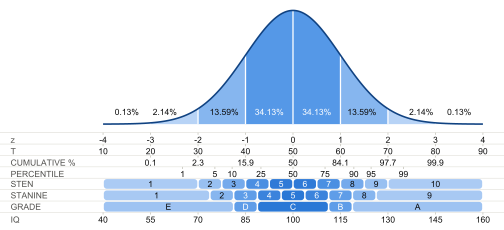

# Standard Normal Plot

Draws the standard normal curve in R with score scales lined up under it: z, T, cumulative percentage, percentile, sten, stanine, grade and IQ, so that a score on one scale can be read off on the others. Colour shows how common a score is, in blues, reds or greens: the more cases an interval under the curve, or a band of the scales, holds, the darker it is. A diverging palette colours the bands blue below the mean and red above it instead. Each palette has a light and a dark mode.

# Installation Instructions
## install R
installation instructions can be found here: https://cran.r-project.org/  
## install RStudio IDE (optional but a good idea)  
installation instructions can be found here: https://posit.co/downloads/  

open RStudio and type in the console:
```
install.packages("devtools")
library(devtools)
install_github("sedzinfo/snp")
```

Without devtools, install the source tarball of the [latest release](https://github.com/sedzinfo/snp/releases/tag/latest), which is rebuilt from `master` on every change, together with the PDF manual:

```r
install.packages(
  "https://github.com/sedzinfo/snp/releases/download/latest/snp_0.0.0.9000.tar.gz",
  repos = NULL, type = "source"
)
```

# Usage
```r
library(snp)
plot_normal()                                   # for figures about 7 inches wide
plot_normal(size = 5)                           # for figures about 12 inches wide
plot_normal(palette = "greens", mode = "dark")  # blues, reds, greens or diverging; light or dark
ggsave("snp.png", plot_normal(), width = 7, height = 3.2)

# your own scales: tick marks for a test score and bands for performance levels
my_scales <- rbind(data.frame(scale = "SCORE", z = -3:3, z_end = NA, label = seq(20, 80, 10)),
                   data.frame(scale = "LEVEL", z = c(-4, -1, 1), z_end = c(-1, 1, 4), label = c("Low", "Average", "High")))
plot_normal(my_scales)
```

`standard_normal_scales_data()` returns the standard scales as a data frame, to start from when changing them.

More examples, from palettes and sizes to scales of your own, are in the [Examples](https://sedzinfo.github.io/snp/articles/examples.html) article, and [Saving as vector graphics](https://sedzinfo.github.io/snp/articles/vector-graphics.html) shows how to save the chart as PDF, SVG, EMF or EPS.

# Screenshot



# Palettes

`palette` sets the colours, `"blues"` (the default), `"reds"`, `"greens"` or `"diverging"`, and `mode` the background, `"light"` (the default) or `"dark"`:


---


