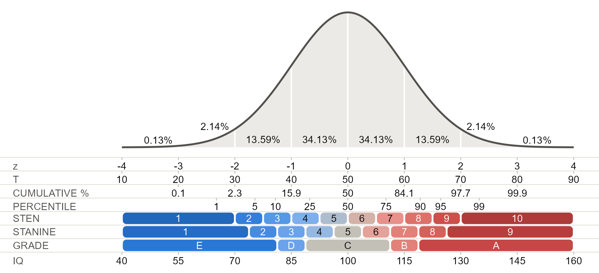

# Standard Normal Plot

Draws the standard normal curve in R with score scales lined up under it: z, T, cumulative percentage, percentile, sten, stanine, grade and IQ, so that a score on one scale can be read off on the others. The sten, stanine and grade bands are coloured by where they sit against the mean: gray at the mean, blue below it and red above it, darker the further from the mean.

# Installation Instructions
## install R
installation instructions can be found here: https://cran.r-project.org/  
## install RStudio IDE (optional but a good idea)  
installation instructions can be found here: https://posit.co/downloads/  

open RStudio and type in the console:
```
install.packages("devtools")
library(devtools)
install_github("sedzinfo/snp")
```

Without devtools, install the source tarball of the [latest release](https://github.com/sedzinfo/snp/releases/tag/latest), which is rebuilt from `master` on every change, together with the PDF manual:

```r
install.packages(
  "https://github.com/sedzinfo/snp/releases/download/latest/snp_0.0.0.9000.tar.gz",
  repos = NULL, type = "source"
)
```

# Usage
```r
library(snp)
standard_normal_plot()            # for large figures, about 12 inches wide
standard_normal_scales()          # the same chart for figures about 7 inches wide
ggsave("snp.png", standard_normal_scales(), width = 7, height = 3.2)

# your own scales: tick marks for a test score and bands for performance levels
my_scales <- rbind(data.frame(scale = "SCORE", z = -3:3, z_end = NA, label = seq(20, 80, 10)),
                   data.frame(scale = "LEVEL", z = c(-4, -1, 1), z_end = c(-1, 1, 4), label = c("Low", "Average", "High")))
standard_normal_custom(my_scales)
```

`standard_normal_scales_data()` returns the standard scales as a data frame, to start from when changing them.

# Screenshot



---


