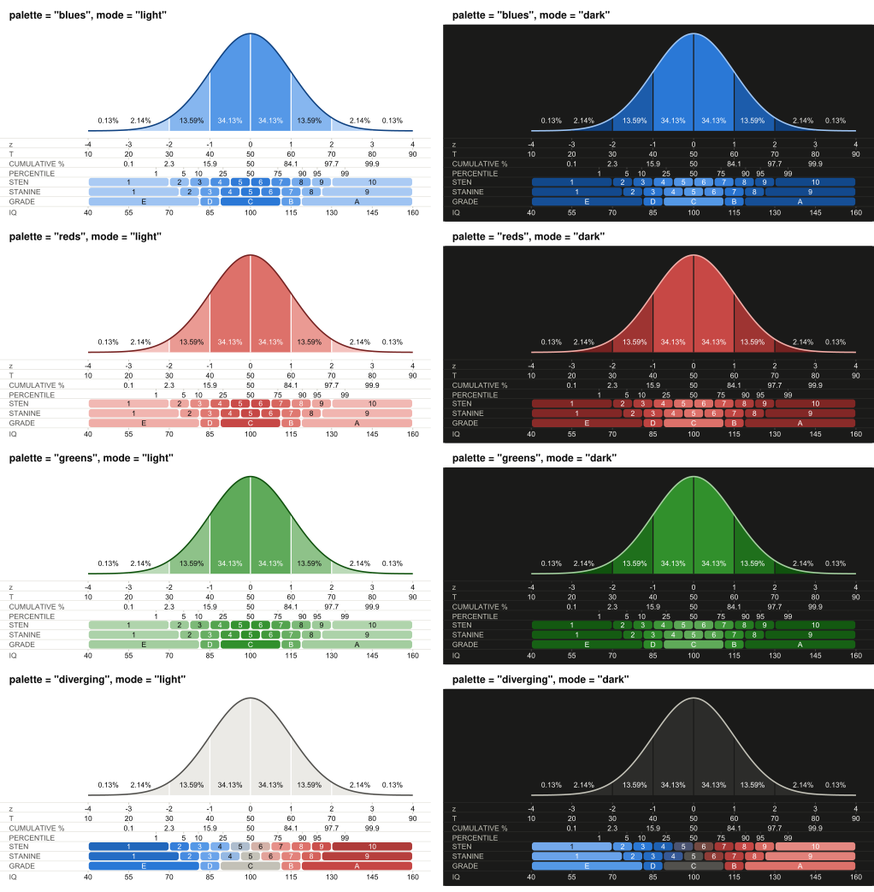

# Standard Normal Plot

[Help pages](https://sedzinfo.github.io/snp/reference/)

## What it does

Draws the standard normal curve in R with score scales lined up under it: z, T, cumulative percentage, percentile, sten, stanine, grade and IQ, so that a score on one scale can be read off on the others. Colour shows how common a score is, in blues, reds or greens: the more cases an interval under the curve, or a band of the scales, holds, the darker it is. A diverging palette colours the bands blue below the mean and red above it instead. Each palette has a light and a dark mode.

## Installation

### 1. Install R

Download R from [CRAN](https://cran.r-project.org/), for Windows, macOS or Linux, and run the installer.

### 2. Install RStudio or Positron

An editor makes R easier to use. It is optional, and both are free, from Posit:

- [RStudio Desktop](https://posit.co/download/rstudio-desktop/)
- [Positron](https://positron.posit.co/download.html), which also runs Python

### 3. Install snp

Run one of these in RStudio, Positron or the R console. Each one also installs the packages snp needs.

#### From R-universe (recommended)

```r
install.packages(
  "snp",
  repos = c("https://sedzinfo.r-universe.dev", "https://cloud.r-project.org")
)
```

[R-universe](https://sedzinfo.r-universe.dev/snp) builds snp from this repository after every change, ready to install on Windows, macOS and Linux, and CRAN provides the packages it needs.

#### From GitHub

```r
install.packages("pak")   # once
pak::pak("sedzinfo/snp")
```

#### From the release tarball

The [latest release](https://github.com/sedzinfo/snp/releases/tag/latest) has the source tarball and the PDF manual, rebuilt from `main` on every change:

```r
install.packages("pak")   # once
pak::pak("url::https://github.com/sedzinfo/snp/releases/download/latest/snp_0.1.0.tar.gz")
```

#### From a clone of the repository

This repository keeps no files in [Git LFS](https://git-lfs.com), so a plain clone with [Git](https://git-scm.com/downloads) has everything:

```bash
git clone https://github.com/sedzinfo/snp.git
```

```r
install.packages("pak")   # once
pak::local_install("path/to/snp")
```

## Usage

```r
library(snp)
plot_normal()                                   # for figures about 7 inches wide
plot_normal(size = 5)                           # for figures about 12 inches wide
plot_normal(palette = "greens", mode = "dark")  # blues, reds, greens or diverging; light or dark
ggsave("snp.png", plot_normal(), width = 7, height = 3.2)

# your own scales: tick marks for a test score and bands for performance levels
my_scales <- rbind(data.frame(scale = "SCORE", z = -3:3, z_end = NA, label = seq(20, 80, 10)),
                   data.frame(scale = "LEVEL", z = c(-4, -1, 1), z_end = c(-1, 1, 4), label = c("Low", "Average", "High")))
plot_normal(my_scales)
```

`standard_normal_scales_data()` returns the standard scales as a data frame, to start from when changing them.

More examples, from palettes and sizes to scales of your own, are in the [Examples](https://sedzinfo.github.io/snp/articles/examples.html) article, and [Saving as vector graphics](https://sedzinfo.github.io/snp/articles/vector-graphics.html) shows how to save the chart as PDF, SVG, EMF or EPS.

## Screenshots


## Palettes

`palette` sets the colours, `"blues"` (the default), `"reds"`, `"greens"` or `"diverging"`, and `mode` the background, `"light"` (the default) or `"dark"`:



---

[](https://sedzinfo.r-universe.dev/snp)


